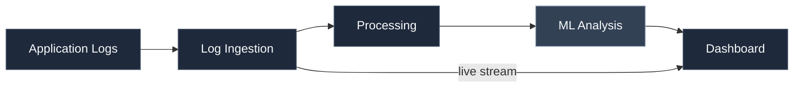
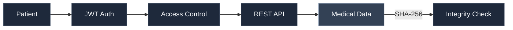

 

 

I build AI-powered applications, backend systems, and cloud-ready infrastructure. I like taking messy real-world problems, breaking them down, and turning them into software that works.

> Click any folder below to expand it.

 

<b>📂 laukik/</b>

 

<b>📂 about/</b>

 

| | |
|:--|:--|
| **Role** | Software Engineer |
| **Focus** | Machine Learning, LLM applications, backend systems, cloud |
| **Education** | B.E. Information Technology, Savitribai Phule Pune University (2022 – 2026) |
| **Working on** | AI Log Intelligence System, Patient-Owned Health Data Platform |

<b>📂 skills/</b>

 

📂 languages/

 

📂 ai-ml/

 

Machine Learning · LLM Applications · RAG Pipelines · Vector Embeddings · Prompt Engineering

📂 backend/

 

REST APIs · Authentication · Role-based access control · Scalable data processing

📂 frontend/

 

📂 databases/

 

📂 cloud-devops/

 

AWS EC2 · S3 · RDS · IAM · Docker

📂 tools/

 

<b>📂 projects/</b>

 

📂 ai-log-intelligence-system/

 

An AI-powered observability platform for real-time log ingestion, analysis, anomaly detection, and debugging.

- Real-time log ingestion with Socket.IO live streaming
- Automated pattern detection and ML-based anomaly detection
- REST APIs and interactive monitoring dashboards
- Log filtering and metadata processing
- Dockerized services with AWS deployment architecture

 

📂 patient-owned-health-data-platform/

 

A secure healthcare platform built around patient-controlled records, authentication, access control, and data integrity.

- JWT authentication and role-based access control
- Django REST Framework APIs
- SHA-256 integrity verification with blockchain-inspired verification
- Patient-controlled record management
- Dockerized, modular backend

<b>📂 education/</b>

 

**Bachelor of Engineering, Information Technology**
Savitribai Phule Pune University · 2022 – 2026

<b>📂 contact/</b>

 

- Email: [laukikparashare@gmail.com](mailto:laukikparashare@gmail.com)
- LinkedIn: [laukik-parashare](https://www.linkedin.com/in/laukik-parashare-7373a326b/)
- GitHub: [Rockyyy2312](https://github.com/Rockyyy2312)

 

