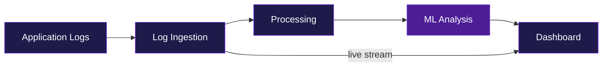
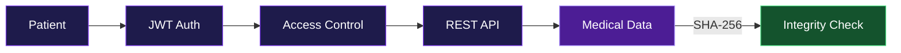
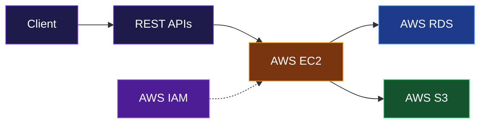
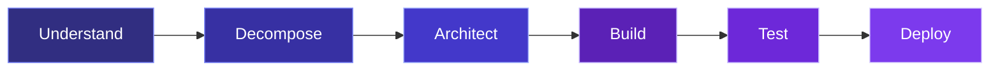

<!-- ═══════════════════ HEADER ═══════════════════ -->
<div align="center">


<a href="https://git.io/typing-svg">

</a>


</div>

<br/>

<!-- ═══════════════════ ABOUT ═══════════════════ -->


```ts
const laukik = {
  role: "Software Engineer",
  focus: ["Machine Learning", "LLM Apps", "Backend Systems", "Cloud"],
  education: "B.E. Information Technology @ SPPU (2022 — 2026)",
  currentlyBuilding: ["AI Log Intelligence System", "Patient-Owned Health Data Platform"],
  philosophy: "Build systems that make difficult things easier.",
  funFact: "I break my own code before users do.",
};
```

<br/>

<!-- ═══════════════════ FOCUS ═══════════════════ -->


<table>
<tr>
<td width="50%" valign="top">

### 🧠 Artificial Intelligence
- Machine Learning
- LLM Applications
- RAG Pipelines
- Vector Embeddings
- Prompt Engineering
- AI-powered Systems

</td>
<td width="50%" valign="top">

### ☁️ Engineering
- Backend Architecture
- REST APIs
- Cloud Infrastructure
- Docker
- AWS
- Scalable Data Processing

</td>
</tr>
</table>

<br/>

<!-- ═══════════════════ STACK ═══════════════════ -->


<div align="center">

| | |
|:---|:---|
| **Languages** |  |
| **AI / ML** |   |
| **Backend** |  |
| **Frontend** |  |
| **Databases** |  |
| **Cloud & DevOps** |  |
| **Tools** |  |

</div>

<br/>

<!-- ═══════════════════ PROJECTS ═══════════════════ -->


### 🔭 AI Log Intelligence & Observability System

> Real-time log ingestion, analysis, anomaly detection, and debugging workflows — powered by ML.



| ⚡ Core Features | 🧰 Tech |
|:---|:---|
| Real-time log ingestion & Socket.IO live streaming |  |
| Automated pattern detection | |
| ML-based anomaly detection | |
| REST APIs & interactive monitoring dashboards | |
| Log filtering & metadata processing | |
| Dockerized services, AWS deployment architecture | |

<div align="center">
<a href="https://ai-log-intelligence-frontend.vercel.app/"></a>
<a href="https://github.com/Rockyyy2312/AI-log-Intelligence-system"></a>
</div>

<br/>

### 🏥 Patient-Owned Health Data Platform

> A secure healthcare platform built around patient-controlled records, authentication, access control, and data integrity.



| ⚡ Key Features | 🧰 Tech |
|:---|:---|
| JWT authentication & role-based access control |  |
| Django REST Framework APIs | |
| SHA-256 integrity verification | |
| Blockchain-inspired verification | |
| Dockerized, modular backend | |
| Patient-controlled record management | |

<br/>

<!-- ═══════════════════ CLOUD ═══════════════════ -->




<div align="center">


</div>

<br/>

<!-- ═══════════════════ EDUCATION & CERTS ═══════════════════ -->


<div align="center">

<table>
<tr>
<td align="center" width="33%">
<br/><br/>
<b>B.E. Information Technology</b><br/>
<sub>Savitribai Phule Pune University</sub><br/>
<sub>2022 — 2026</sub>
</td>
<td align="center" width="33%">
<br/><br/>
<b>Machine Learning Specialization</b><br/>
<sub>Supervised • Unsupervised • Reinforcement Learning</sub>
</td>
<td align="center" width="33%">
<br/><br/>
<b>AWS with Python</b><br/>
<sub>EC2 • S3 • RDS • IAM</sub>
</td>
</tr>
</table>

</div>

<br/>

<!-- ═══════════════════ MINDSET ═══════════════════ -->




<div align="center">
<i>Complexity is not the goal. Solving the problem is.</i>
</div>

<br/>

<!-- ═══════════════════ BUILDING TOWARD ═══════════════════ -->


<table align="center">
<tr>
<td align="center" width="25%">

### 🤖
**AI Systems**
<br/><sub>Intelligent apps that solve practical problems</sub>

</td>
<td align="center" width="25%">

### ⚙️
**Backend Systems**
<br/><sub>Reliable APIs & scalable architectures</sub>

</td>
<td align="center" width="25%">

### ☁️
**Cloud Engineering**
<br/><sub>Production-oriented infrastructure</sub>

</td>
<td align="center" width="25%">

### 💡
**Real Impact**
<br/><sub>Tech that makes life easier</sub>

</td>
</tr>
</table>

<br/>

<!-- ═══════════════════ CONNECT ═══════════════════ -->


<div align="center">

<a href="mailto:laukikparashare@gmail.com"></a>
<a href="https://www.linkedin.com/in/laukik-parashare-7373a326b/"></a>
<a href="https://github.com/Rockyyy2312"></a>

<br/><br/>


</div>
