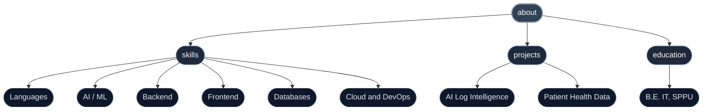
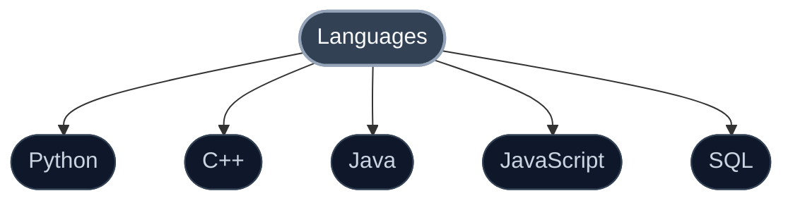
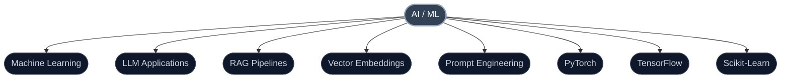
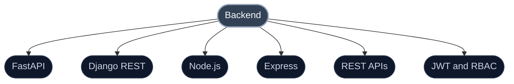
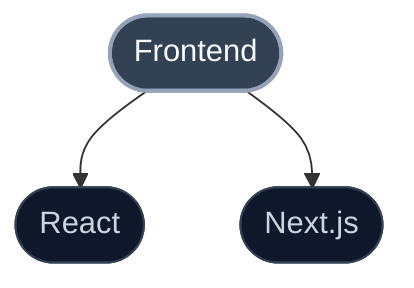
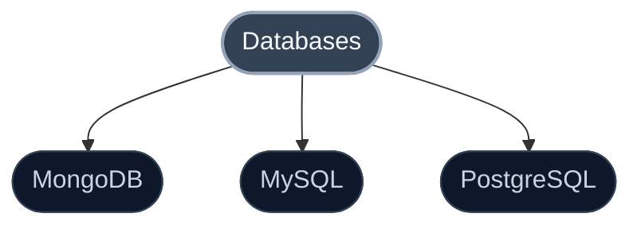
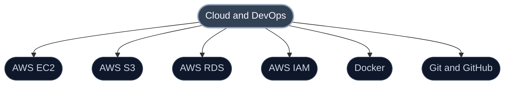
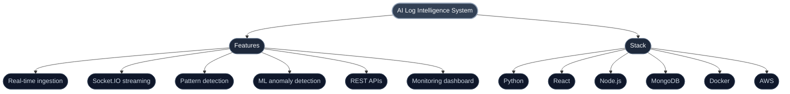
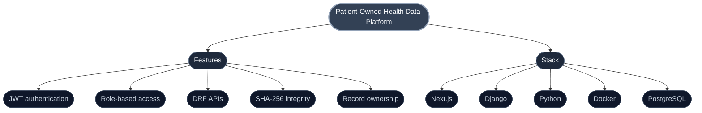
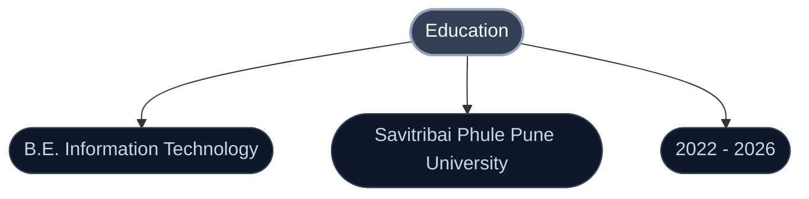

 

 

Click a branch to expand it

 

<b>skills</b>

 

<b>Languages</b>

 

<b>AI / ML</b>

 

<b>Backend</b>

 

<b>Frontend</b>

 

<b>Databases</b>

 

<b>Cloud and DevOps</b>

 

<b>projects</b>

 

<b>AI Log Intelligence System</b>

 

An AI-powered observability platform for real-time log ingestion, analysis, anomaly detection, and debugging.

<b>Patient-Owned Health Data Platform</b>

 

A secure healthcare platform built around patient-controlled records, authentication, access control, and data integrity.

<b>education</b>

 

 

  

